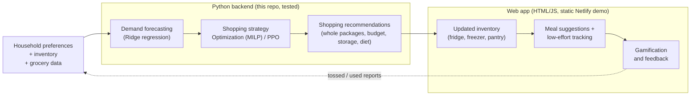
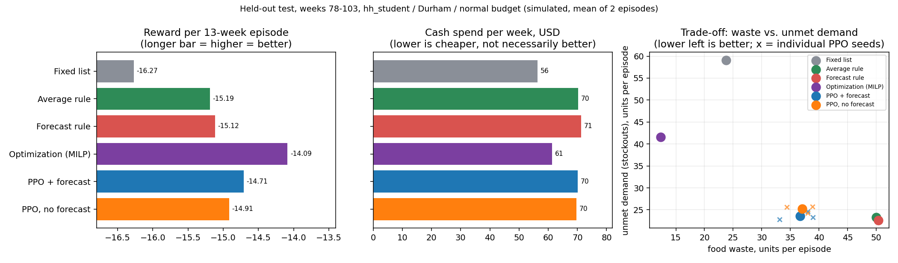

# Smart Grocery Coach

**Smarter grocery decisions. Less food waste.**

Smart Grocery Coach helps a household decide **what to buy, what to cook, and what to use first**, while balancing grocery spending, food waste and keeping the kitchen stocked.
It combines a demand forecast, two shopping strategies (mathematical optimization and a reinforcement-learning agent), an inventory that tracks fridge, freezer and pantry, and a web app that turns the recommendations into a weekly plan.

**Live demo:** https://groceriq.netlify.app/ (a static demo built from precomputed model runs; see [Demo vs. live models](#demo-vs-live-models))

> All demand, prices, budgets, storage sizes and results in this repository are **simulated**. Nothing here is a measured saving for a real household.

---

## The problem

Households routinely buy more than they use, forget what is already in the fridge, and throw food away, while still running out of the things they actually need. Planning meals around a budget and
the food already at home is tedious, so most people don't do it. The result is wasted money and wasted food. The goal of this project is a coach that makes the weekly decision easier,
and that is honest about the trade-off between **spending less**, **wasting less** and **not running out**.

## How it works



What is connected today, and what is not:

| Step | Implemented in | Status in the deployed demo |
|---|---|---|
| Forecasting, Optimization, PPO, constraints, evaluation | Python (`src/`) | Run offline. Their outputs for the evaluated household are **precomputed** into `results/ui/plans.json` |
| Shopping recommendations | Python API (`src/coach_api.py`, `src/coach_server.py`), tested | **Not deployed.** The web demo displays the precomputed replays instead of calling it |
| Inventory, meals, receipt/fridge input, barcode, garden | `ui/coach.html` (browser) | Working in the demo; data stays in the browser (localStorage) |
| AI explanations and photo reading | Netlify Function `netlify/functions/explain.mjs` | Needs an API key set on the server; otherwise the app offers clearly labelled samples |

## Key features

Status is stated per feature. "Demo" means it works in the browser demo, without accounts or a database.

- **Adaptive shopping modes.** Three priorities: *Save Money & Reduce Waste* (Optimization), *Balanced* (a rule that takes the Optimization plan or the RL plan each week) and *Keep My Groceries Stocked* (RL agent with the Ridge forecast).
  In the demo they show precomputed replays of the frozen models for one household; other households use a labelled in-browser preview. The same three priorities exist in the Python API.
- **Weekly shopping recommendations.** A shopping list in whole packages that respects the weekly budget, storage space, diet and allergens, with a short "why this item" trace (forecast, what is at home, what is bought). Tested in Python; precomputed in the demo.
- **Inventory management.** Food is tracked as lots in the fridge, freezer and pantry, with days left. The Python environment models shelf life and freezing/thawing; the demo shows the resulting inventory per week. Demo only: no persistence beyond the browser.
- **Meal suggestions.** Recipes that fit the household's diet and allergens, ranked to use food that expires soon. Ingredients missing at home are added on top of the strategy's purchases only if they fit **whole packages, the weekly budget and storage space** (items that don't fit are left off with a note). Demo.
- **Use-first reminders.** Items close to their last day are highlighted, and "rescue" actions earn points. Estimates come from the forecast and purchases. Demo.
- **Receipt, order-email and fridge-photo input.** An AI model reads the photo or pasted email and updates the inventory after a review step; only exceptions are asked about. Needs a server-side API key; without one, labelled sample data is shown. Experimental.
- **Barcode and nutrition information.** Camera or typed barcodes are looked up in Open Food Facts and checked against the household's diet and allergens. Depends on the public database's coverage. Demo.
- **Virtual garden.** A points-and-garden gamification layer (weekly check-ins, waste-free weeks, rescued food). A motivational prototype, not validated for behaviour change.
- **AI product explanations.** Plain-language explanations of a scanned product through Gemini or Claude. Needs a server-side API key. The prompts forbid medical advice and invented numbers; answers are not verified.

## Technical architecture

Detailed documents are linked after each part; the README only summarises.

- **Demand forecasting.** Weekly demand per household and product is predicted with **Ridge regression** on lagged demand, moving averages, season and holiday/guest/away flags, with walk-forward training so a week is never predicted by a model that saw it.
  Ridge was compared with **XGBoost** on identical features: validation MAE 0.2072 vs 0.2061 purchase units per product-week (WMAPE about 19.7% vs 19.6%), practically equal, so the simpler and more interpretable Ridge was chosen. The app uses the `no_events` variant (guest/away weeks unknown in advance).
  Weeks 4-11 fall back to a 4-week moving average. Code: `src/forecast.py`, interface and safeguards: `src/forecast_table.py`, [docs/RL_EVALUATION.md](docs/RL_EVALUATION.md).
- **Simulation environment.** `GroceryEnv` (Gymnasium) simulates 13-week episodes for one household: inventory lots with shelf life, a fridge, freezer and pantry with capacities, freezing and thawing without resetting freshness, daily consumption of fractional demand, regional weekly prices,
  and a reward that charges consumed food, waste and unmet demand (2x the item price) plus a protein term and a terminal charge for leftover stock. Hard constraints are enforced in code, not by the reward: whole packages, stock cap, storage capacity, weekly budget, diet and allergens.
  Waste is *simulated disposal*, not a food-safety statement. [docs/RL_TECHNICAL_DESIGN.md](docs/RL_TECHNICAL_DESIGN.md), [docs/STORAGE_DATA.md](docs/STORAGE_DATA.md), [docs/REGIONAL_BUDGETS.md](docs/REGIONAL_BUDGETS.md).
- **Optimization (MILP).** Each week a small mixed-integer program (SciPy/HiGHS) chooses the number of packages of every product, weighing purchase cost, expected shortage, expected waste and protein against the forecast, subject to the same constraints as the environment. Its one parameter (demand uncertainty) was tuned on training weeks only. [docs/OPTIMIZATION.md](docs/OPTIMIZATION.md).
- **Reinforcement learning (PPO).** Proximal Policy Optimization (Stable-Baselines3) acts through a normalized action wrapper that converts its output into whole-package orders, then through the same constraint pipeline. A pilot of 300,000 steps and three seeds was trained with and without forecasts; checkpoints were selected on validation weeks only. [docs/RL_PPO_PILOT.md](docs/RL_PPO_PILOT.md), [docs/RL_MODELLING_RULES.md](docs/RL_MODELLING_RULES.md).
- **Evaluation protocol.** Weeks are split into training (4-63), validation (64-77) and a held-out test (78-103, two 13-week episodes). The test was run **once**, after the models, checkpoints and settings were frozen and hashed. [docs/COMPARISON.md](docs/COMPARISON.md), [docs/FINAL_EVALUATION.md](docs/FINAL_EVALUATION.md).
- **Backend API.** `CoachAdapter` (`src/coach_api.py`) runs the frozen Optimization and PPO models on the environment and returns one JSON recommendation (shopping list, inventory, forecast, prices, cost, strategy and the rule that chose it). `src/coach_server.py` serves it over HTTP using only the standard library. [docs/GROCERY_COACH_INTEGRATION.md](docs/GROCERY_COACH_INTEGRATION.md).
- **Frontend.** A single-page interface in plain HTML, CSS and JavaScript (`ui/coach.html`) fed by a JSON payload built in `ui_payload.py`. `app.py` shows it in Streamlit for local use; `build_static.py` produces the static site deployed on Netlify. AI features go through the Netlify Function `netlify/functions/explain.mjs` (Gemini when `GEMINI_API_KEY` is set, otherwise Claude with `ANTHROPIC_API_KEY`). [docs/UI_INTEGRATION.md](docs/UI_INTEGRATION.md).

## Model evaluation and results

Held-out test: weeks 78-103, household `hh_student` (a student living alone), Durham NC prices, a $75 weekly budget, two 13-week episodes, mean of the two. Simulated data; one recorded demand trajectory, so there are
no confidence intervals and no significance claims. PPO rows are the mean of three training seeds. Source: `results/final/test/` and [docs/FINAL_RESULTS.md](docs/FINAL_RESULTS.md).

| Method | Reward per episode (higher is better) | Cash spend, USD per week | Waste, units per episode | Waste cost, USD per episode | Unmet demand, units per episode | Fill rate (value-weighted) |
|---|---:|---:|---:|---:|---:|---:|
| Fixed list | -16.27 | 56.3 | 23.8 | 58.84 | 59.1 | 0.73 |
| Average rule | -15.19 | 70.2 | 50.0 | 124.14 | 23.3 | 0.87 |
| Forecast rule (Ridge) | -15.12 | 71.3 | 50.3 | 128.10 | 22.7 | 0.88 |
| **Optimization (MILP)** | **-14.09** | 61.3 | **12.3** | **31.23** | 41.6 | 0.85 |
| **PPO with forecast** | -14.71 | 70.1 | 36.7 | 97.19 | 23.6 | **0.89** |
| PPO without forecast | -14.91 | 69.6 | 37.1 | 101.96 | 25.2 | 0.88 |
| *Balanced rule (supplementary)* | *-14.16* | *68.6* | *28.0* | *71.69* | *26.1* | *0.90* |

The balanced rule is what the app's "Balanced" option replays. It was evaluated on these weeks after the frozen six-method comparison, with a rule and tolerance fixed beforehand, so it is not part of that comparison.



**The key trade-off.** Optimization buys lean: it spends about 13% less than the average rule and wastes about 75% less, but it leaves roughly 79% more demand unmet (fill rate 0.85, falling to 0.83 in the second test episode).
PPO with the Ridge forecast keeps availability at or above the average rule (fill rate 0.89, the highest of the six frozen methods) and cuts waste by about a quarter, but it does not save money. Neither is best on everything, and
the ranking by reward depends on the reward's weight on running out (2x the item price). That is why the app offers a choice of priorities instead of one answer. The Ridge forecast helps Optimization (which requires it) and slightly helps PPO, but the
difference between PPO with and without forecasts is within the spread of the three seeds.

## Setup and quick start

```bash
git clone https://github.com/gulnargasimzada/smart-grocery-rl && cd smart-grocery-rl
pip install -r requirements_all.txt            # app + RL + optimization (Python 3.11+)

python -m pytest tests -q                      # all tests (the forecast file data/forecast_weekly.csv is included)
streamlit run app.py                           # the web app, locally
python build_static.py                         # builds dist/index.html, the static site used on Netlify

python -m src.coach_server --port 8000         # the Python recommendation API (POST /recommend), see docs/GROCERY_COACH_INTEGRATION.md
python -m src.coach_check                      # runs the API over a validation episode and compares it with the pure models
python -m src.final_eval --verify              # checks that the frozen evaluation state is unchanged
```

AI features need `GEMINI_API_KEY` or `ANTHROPIC_API_KEY` as server-side environment variables (see `.env.example`). Never put keys in the page.

## Repository structure

| Path | Contents |
|---|---|
| `ui/`, `app.py`, `ui_payload.py`, `build_static.py`, `netlify.toml`, `netlify/functions/` | Frontend: interface, Streamlit host, static build, AI function |
| `export_ui_plans.py`, `results/ui/plans.json` | Precomputed model runs that the static demo displays |
| `src/coach_api.py`, `src/coach_server.py`, `src/coach_check.py` | Python recommendation API (adapter, HTTP server, verification) |
| `src/env.py`, `src/rl_wrapper.py`, `src/policies.py`, `src/evaluate.py`, `src/train_rl.py`, `src/report_rl.py` | Environment, action wrapper, baselines, evaluation, PPO training and report |
| `src/optimization.py`, `src/optimization_eval.py` | MILP policy and its evaluation |
| `src/forecast.py`, `src/forecast_table.py` | Ridge/XGBoost forecasting and the strict forecast interface |
| `src/comparison.py`, `src/final_eval.py`, `src/plot_final_results.py` | Unified validation comparison, frozen held-out evaluation, figures |
| `src/data_gen.py`, `src/demand.py`, `src/diets.py`, `src/households_gen.py`, price scripts | Synthetic data generation and shared diet/allergen rules |
| `data/`, `data_rl/` | Products, households, recipes, demand, prices, regional budgets, forecasts; storage rules and capacities |
| `models/`, `results/rl_pilot/selected/` | Saved Ridge models; the six frozen PPO checkpoints |
| `results/` | Evaluation outputs (`final/test` is the one-time held-out run) |
| `tests/` | Unit and integration tests |
| `docs/` | Technical documentation, indexed in [docs/README.md](docs/README.md) |

## Demo vs. live models

The Netlify site is a static page. It does **not** run Python, Optimization or PPO when you click. The shopping priorities show precomputed replays of the frozen models on the held-out weeks for one household, and every other household uses an in-browser preview, both labelled in the interface.
The Python API in this repository does run the real models and is covered by tests (adapter output equals the pure models over a full validation episode), but it is not deployed. Connecting it needs a Python host (container or small VM) with HTTPS and a `fetch` from the page to `POST /recommend`; the steps are in [docs/UI_INTEGRATION.md](docs/UI_INTEGRATION.md).

## Limitations

- **Simulated data.** Demand, budgets, storage rules and the dynamics are synthetic; only the price anchors come from real shelf prices (Open Prices). Results describe the simulation, not real households or real savings.
- **Narrow evaluation.** One household and region, one recorded demand trajectory, a two-episode test. PPO was trained only for that setting (other households fall back to Optimization in the API) and as a short pilot: the curves were still improving.
- **Reward-dependent ranking.** Which method is "best" depends on the weight given to unmet demand and on how waste is valued.
- **Waste is simulated disposal,** based on assumed shelf lives; it is not food-safety advice.
- **Demo scope.** No accounts, sync or database; inventory lives in the browser. AI features can be wrong and need a server-side key. Receipt/fridge-photo reading and the garden are prototypes.
- **Not a medical or nutrition-advice tool.**

## Roadmap

1. Deploy the Python API and call it from the web app for live recommendations, with real inventory input.
2. Train and evaluate PPO for more households, regions and budgets, for longer, with several demand trajectories to obtain proper uncertainty estimates.
3. Evaluate with real user inventory and purchase data, and measure whether the garden and reminders change behaviour.
4. Use guest/away information when a household provides it (the `with_events` forecast) and learn personal preferences.
5. Add persistent accounts, household sharing and a supervised pilot.

## Team, data and credits

Contributors, from the commit history: Gulnar Gasimzada (data generation, demand forecasting), Farnoosh Memari (simulation environment, Optimization, PPO, evaluation, Python API) and Supriya ([@surpiya19](https://github.com/surpiya19), web app and deployment).
Real shelf prices come from [Open Prices](https://prices.openfoodfacts.org/) by Open Food Facts (ODbL 1.0; credit required and derived databases stay under ODbL), nutrition from USDA FoodData Central, and barcode data from Open Food Facts. See [docs/PRICE_DATA.md](docs/PRICE_DATA.md).
No software license file has been added yet; add one before reuse.
