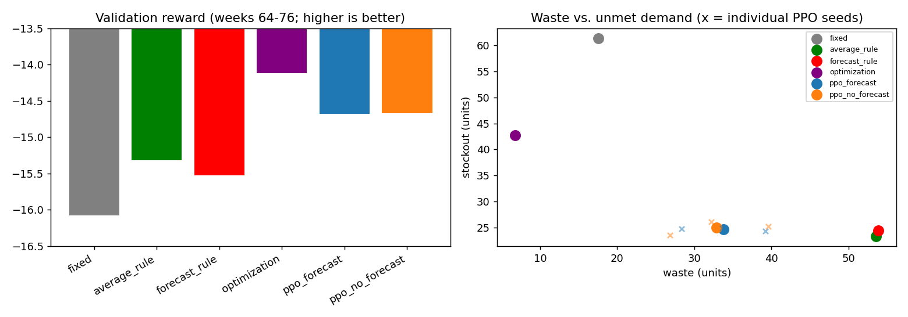

# Unified validation comparison (validation split only; test weeks 78-103 not run)

hh_student, durham_nc, normal budget (synthetic), default storage; validation episode weeks 64-76. Every method runs the same `EpisodeSpec` through the unchanged environment: same prices, recorded demand, budget, initial inventory and metrics. Forecasts: the same verified Ridge `no_events` table for every forecast-dependent method. PPO checkpoints are the six selected ones from `results/rl_pilot/selected/` (loaded, not retrained; selected on validation windows 64 and 65, so PPO validation numbers are optimistic). Optimization: weekly MILP, delta 0.4 tuned on the training windows only. Deterministic replay of ONE recorded trajectory: no confidence intervals or significance claims.

## Results (canonical validation episode)
| index | reward | cash_spend | net_cost | waste_units | waste_cost | stockout_units | stockout_value | fill_rate_value | protein_coverage | terminal_charge |
|---|---|---|---|---|---|---|---|---|---|---|
| fixed | -16.08 | 732.57 | 730.20 | 17.56 | 46.52 | 61.42 | 230.61 | 0.74 | 1.12 | 17.18 |
| average_rule | -15.32 | 926.15 | 928.99 | 53.56 | 133.56 | 23.28 | 110.05 | 0.88 | 1.44 | 9.77 |
| forecast_rule | -15.53 | 908.77 | 917.99 | 53.89 | 138.59 | 24.43 | 123.22 | 0.86 | 1.43 | 6.08 |
| optimization | -14.12 | 797.69 | 782.92 | 6.78 | 18.14 | 42.68 | 138.11 | 0.85 | 1.44 | 9.39 |
| ppo_forecast_mean | -14.68 | 918.08 | 913.35 | 33.76 | 101.19 | 24.60 | 93.79 | 0.90 | 1.48 | 10.97 |
| ppo_forecast_seed0 | -14.44 | 906.24 | 899.69 | 28.38 | 80.62 | 24.73 | 91.49 | 0.90 | 1.49 | 16.18 |
| ppo_forecast_seed1 | -14.91 | 919.84 | 923.05 | 39.25 | 119.36 | 24.24 | 97.69 | 0.89 | 1.47 | 5.57 |
| ppo_forecast_seed2 | -14.69 | 928.15 | 917.30 | 33.64 | 103.59 | 24.84 | 92.19 | 0.90 | 1.49 | 11.16 |
| ppo_no_forecast_mean | -14.67 | 917.94 | 911.08 | 32.89 | 97.50 | 24.90 | 94.66 | 0.89 | 1.49 | 12.98 |
| ppo_no_forecast_seed0 | -14.23 | 913.07 | 901.35 | 26.86 | 74.73 | 23.47 | 83.03 | 0.91 | 1.52 | 15.59 |
| ppo_no_forecast_seed1 | -15.03 | 929.50 | 928.13 | 39.63 | 119.89 | 25.22 | 99.59 | 0.89 | 1.47 | 12.31 |
| ppo_no_forecast_seed2 | -14.75 | 911.24 | 903.75 | 32.19 | 97.87 | 26.01 | 101.36 | 0.89 | 1.47 | 11.06 |

Remaining metrics: stockout days, terminal inventory basis and credit are in `comparison_table.csv`.

## Change relative to the Average Rule (%)
(x - AR) / |AR| x 100. Positive is better for reward, fill rate and protein coverage; negative is better for spend, net cost, waste, stockouts and terminal charge.
| index | reward | cash_spend | net_cost | waste_units | waste_cost | stockout_units | stockout_value | fill_rate_value | protein_coverage | terminal_charge |
|---|---|---|---|---|---|---|---|---|---|---|
| fixed | -4.9 | -20.9 | -21.4 | -67.2 | -65.2 | +163.8 | +109.5 | -15.3 | -22.5 | +76.0 |
| forecast_rule | -1.3 | -1.9 | -1.2 | +0.6 | +3.8 | +4.9 | +12.0 | -1.7 | -0.5 | -37.7 |
| optimization | +7.8 | -13.9 | -15.7 | -87.3 | -86.4 | +83.3 | +25.5 | -3.6 | +0.4 | -3.9 |
| ppo_forecast_mean | +4.2 | -0.9 | -1.7 | -37.0 | -24.2 | +5.7 | -14.8 | +2.1 | +3.2 | +12.3 |
| ppo_forecast_seed0 | +5.8 | -2.1 | -3.2 | -47.0 | -39.6 | +6.2 | -16.9 | +2.4 | +3.9 | +65.7 |
| ppo_forecast_seed1 | +2.7 | -0.7 | -0.6 | -26.7 | -10.6 | +4.1 | -11.2 | +1.6 | +2.4 | -43.0 |
| ppo_forecast_seed2 | +4.1 | +0.2 | -1.3 | -37.2 | -22.4 | +6.7 | -16.2 | +2.3 | +3.4 | +14.3 |
| ppo_no_forecast_mean | +4.2 | -0.9 | -1.9 | -38.6 | -27.0 | +6.9 | -14.0 | +2.0 | +3.4 | +32.9 |
| ppo_no_forecast_seed0 | +7.1 | -1.4 | -3.0 | -49.9 | -44.0 | +0.8 | -24.6 | +3.4 | +5.8 | +59.6 |
| ppo_no_forecast_seed1 | +1.9 | +0.4 | -0.1 | -26.0 | -10.2 | +8.3 | -9.5 | +1.3 | +2.2 | +26.0 |
| ppo_no_forecast_seed2 | +3.7 | -1.6 | -2.7 | -39.9 | -26.7 | +11.7 | -7.9 | +1.1 | +2.4 | +13.2 |

## Trade-offs: Optimization vs. PPO
- **Optimization** has the best reward (-14.12 vs Average Rule -15.32, PPO means -14.68 / -14.67). It cuts simulated waste to 6.8 units ($18) from 53.6 units ($134), and spends $798 against $926.
- The price is unmet demand: 42.7 stockout units ($138) and fill rate 0.85, against 23.3 units ($110) and 0.88 for the Average Rule.
- **PPO** (mean of 3 seeds) keeps the Average Rule's service level (stockouts 24.6 / 24.9 units, fill rate 0.90 / 0.89) and reduces waste to 33.8 / 32.9 units ($101 / $97), less than Optimization does.
- Optimization versus the PPO means: waste 6.8 vs 33.3 units (PPO average of both agents), stockouts 42.7 vs 24.8 units, fill rate 0.85 vs 0.90, cash spend $798 vs $918. Optimization trades more unmet demand for much less waste and lower spending; PPO keeps service closer to the Average Rule.
- Protein coverage is 1.44 for Optimization against 1.44 (Average Rule) and 1.49 (PPO); values above 1 mean the recorded demand already exceeds the 340 g target.

## Supplementary: mean of the two complete validation windows (64 and 65; they overlap by 12 weeks)
| index | reward | cash_spend | net_cost | waste_units | waste_cost | stockout_units | stockout_value | fill_rate_value | protein_coverage | terminal_charge |
|---|---|---|---|---|---|---|---|---|---|---|
| fixed | -16.23 | 735.28 | 731.21 | 18.36 | 49.72 | 61.05 | 233.95 | 0.74 | 1.10 | 19.73 |
| average_rule | -15.20 | 928.48 | 925.69 | 52.13 | 127.74 | 22.71 | 107.10 | 0.88 | 1.44 | 10.65 |
| forecast_rule | -15.48 | 916.21 | 920.14 | 53.91 | 138.91 | 24.02 | 120.50 | 0.87 | 1.44 | 6.71 |
| optimization | -14.03 | 801.87 | 790.06 | 7.14 | 18.63 | 41.25 | 131.02 | 0.85 | 1.45 | 11.19 |
| ppo_forecast_mean | -14.60 | 917.22 | 908.03 | 32.10 | 95.57 | 24.58 | 93.43 | 0.90 | 1.48 | 12.04 |
| ppo_forecast_seed0 | -14.31 | 912.37 | 899.40 | 27.52 | 75.83 | 24.16 | 87.01 | 0.90 | 1.50 | 17.02 |
| ppo_forecast_seed1 | -14.83 | 920.22 | 916.79 | 36.21 | 111.36 | 24.40 | 97.57 | 0.89 | 1.47 | 8.46 |
| ppo_forecast_seed2 | -14.66 | 919.06 | 907.91 | 32.57 | 99.52 | 25.19 | 95.73 | 0.89 | 1.48 | 10.65 |
| ppo_no_forecast_mean | -14.70 | 917.02 | 908.30 | 32.88 | 96.67 | 25.00 | 97.21 | 0.89 | 1.48 | 14.10 |
| ppo_no_forecast_seed0 | -14.31 | 911.13 | 898.71 | 26.77 | 74.98 | 23.93 | 87.41 | 0.90 | 1.51 | 16.82 |
| ppo_no_forecast_seed1 | -15.02 | 922.78 | 915.81 | 38.86 | 112.55 | 25.75 | 105.21 | 0.88 | 1.46 | 13.77 |
| ppo_no_forecast_seed2 | -14.78 | 917.14 | 910.38 | 33.00 | 102.47 | 25.31 | 99.01 | 0.89 | 1.48 | 11.70 |

## Integration checks
- Forecast received by each forecast-dependent method equals the table's no_events forecasts for weeks 64-76, and only those weeks (no other week requested): {"forecast_rule": {"weeks_requested": true, "values_equal_table": true}, "optimization": {"weeks_requested": true, "values_equal_table": true}, "ppo_forecast_seed0": {"weeks_requested": true, "values_equal_table": true}, "ppo_forecast_seed1": {"weeks_requested": true, "values_equal_table": true}, "ppo_forecast_seed2": {"weeks_requested": true, "values_equal_table": true}}
- Optimization orders on this episode vs. the environment pipeline (units removed; 0 = already feasible): rounding 0.0, stock cap 0.0, storage 0.0, budget 0.0; maximum weekly budget use 1.000.
- Baselines and PPO checkpoints reproduce the earlier results (`tests/test_comparison.py`): `results/evaluation/report_validation.md` and `results/rl_pilot/checkpoint_results.csv`.
