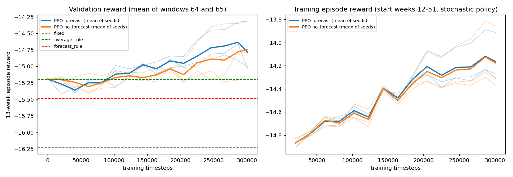

# PPO pilot: validation results (selection on validation windows only; test weeks never run)

hh_student, durham_nc, normal budget, default storage, 13-week episodes. Training start weeks 12-51; seeds [0, 1, 2]; 300000 timesteps per run (identical for both agents). Checkpoints every ~20k steps, plus step 0.
Checkpoint selection = best mean validation reward over the two complete windows starting in weeks [64, 65] (they overlap, so this is effectively one trajectory). The table below reports the canonical validation episode (weeks 64-76). Because checkpoints were chosen on these same weeks, the selected numbers are optimistic; `final` (last checkpoint) and `initial` (step 0) are shown for comparison. Deterministic replay of one recorded trajectory: no confidence intervals or significance claims.

## Verdict
- PPO forecast: selected checkpoints beat the Average Rule (reward -15.32) in 3 of 3 seeds on the canonical validation episode (mean -14.68, best -14.44, worst -14.91).
- PPO no_forecast: selected checkpoints beat the Average Rule (reward -15.32) in 3 of 3 seeds on the canonical validation episode (mean -14.67, best -14.23, worst -15.03).

## Baselines, canonical validation episode (weeks 64-76)
| index | reward | cash_spend | waste_cost | waste_units | stockout_units | stockout_value | fill_rate_value | protein_coverage |
|---|---|---|---|---|---|---|---|---|
| fixed | -16.08 | 732.57 | 46.52 | 17.56 | 61.42 | 230.61 | 0.74 | 1.12 |
| average_rule | -15.32 | 926.15 | 133.56 | 53.56 | 23.28 | 110.05 | 0.88 | 1.44 |
| forecast_rule | -15.53 | 908.77 | 138.59 | 53.89 | 24.43 | 123.22 | 0.86 | 1.43 |

## PPO checkpoints, canonical validation episode (mean over seeds)
| agent | checkpoint | reward | cash_spend | waste_cost | waste_units | stockout_units | stockout_value | fill_rate_value | protein_coverage | reward_both_windows | timesteps |
|---|---|---|---|---|---|---|---|---|---|---|---|
| forecast | final | -14.79 | 912.29 | 101.89 | 33.26 | 25.82 | 99.87 | 0.89 | 1.47 | -14.78 | 301056.00 |
| forecast | initial | -15.31 | 925.75 | 134.64 | 53.58 | 23.25 | 108.85 | 0.88 | 1.44 | -15.19 | 0.00 |
| forecast | selected | -14.68 | 918.08 | 101.19 | 33.76 | 24.60 | 93.79 | 0.90 | 1.48 | -14.60 | 284672.00 |
| no_forecast | final | -14.76 | 908.14 | 95.03 | 31.52 | 26.18 | 102.10 | 0.89 | 1.48 | -14.75 | 301056.00 |
| no_forecast | initial | -15.31 | 925.75 | 134.64 | 53.58 | 23.25 | 108.85 | 0.88 | 1.44 | -15.19 | 0.00 |
| no_forecast | selected | -14.67 | 917.94 | 97.50 | 32.89 | 24.90 | 94.66 | 0.89 | 1.49 | -14.70 | 257365.33 |

## PPO per seed
| agent | seed | checkpoint | timesteps | reward | cash_spend | waste_cost | waste_units | stockout_units | stockout_value | fill_rate_value | protein_coverage | reward_both_windows |
|---|---|---|---|---|---|---|---|---|---|---|---|---|
| forecast | 0 | selected | 301056 | -14.44 | 906.24 | 80.62 | 28.38 | 24.73 | 91.49 | 0.90 | 1.49 | -14.31 |
| forecast | 0 | final | 301056 | -14.44 | 906.24 | 80.62 | 28.38 | 24.73 | 91.49 | 0.90 | 1.49 | -14.31 |
| forecast | 0 | initial | 0 | -15.32 | 926.15 | 133.56 | 53.56 | 23.28 | 110.05 | 0.88 | 1.44 | -15.20 |
| forecast | 1 | selected | 266240 | -14.91 | 919.84 | 119.36 | 39.25 | 24.24 | 97.69 | 0.89 | 1.47 | -14.83 |
| forecast | 1 | final | 301056 | -15.05 | 912.41 | 119.28 | 36.79 | 25.72 | 105.73 | 0.88 | 1.46 | -15.00 |
| forecast | 1 | initial | 0 | -15.32 | 926.15 | 133.56 | 53.56 | 23.28 | 110.05 | 0.88 | 1.44 | -15.20 |
| forecast | 2 | selected | 286720 | -14.69 | 928.15 | 103.59 | 33.64 | 24.84 | 92.19 | 0.90 | 1.49 | -14.66 |
| forecast | 2 | final | 301056 | -14.89 | 918.23 | 105.75 | 34.61 | 27.01 | 102.38 | 0.89 | 1.46 | -15.03 |
| forecast | 2 | initial | 0 | -15.28 | 924.94 | 136.80 | 53.61 | 23.18 | 106.46 | 0.88 | 1.45 | -15.18 |
| no_forecast | 0 | selected | 301056 | -14.23 | 913.07 | 74.73 | 26.86 | 23.47 | 83.03 | 0.91 | 1.52 | -14.31 |
| no_forecast | 0 | final | 301056 | -14.23 | 913.07 | 74.73 | 26.86 | 23.47 | 83.03 | 0.91 | 1.52 | -14.31 |
| no_forecast | 0 | initial | 0 | -15.32 | 926.15 | 133.56 | 53.56 | 23.28 | 110.05 | 0.88 | 1.44 | -15.20 |
| no_forecast | 1 | selected | 184320 | -15.03 | 929.50 | 119.89 | 39.63 | 25.22 | 99.59 | 0.89 | 1.47 | -15.02 |
| no_forecast | 1 | final | 301056 | -15.28 | 899.20 | 112.56 | 35.51 | 29.17 | 123.12 | 0.86 | 1.46 | -15.13 |
| no_forecast | 1 | initial | 0 | -15.32 | 926.15 | 133.56 | 53.56 | 23.28 | 110.05 | 0.88 | 1.44 | -15.20 |
| no_forecast | 2 | selected | 286720 | -14.75 | 911.24 | 97.87 | 32.19 | 26.01 | 101.36 | 0.89 | 1.47 | -14.78 |
| no_forecast | 2 | final | 301056 | -14.76 | 912.16 | 97.79 | 32.21 | 25.92 | 100.15 | 0.89 | 1.47 | -14.79 |
| no_forecast | 2 | initial | 0 | -15.28 | 924.94 | 136.80 | 53.61 | 23.18 | 106.46 | 0.88 | 1.45 | -15.18 |

## Baselines on the selection windows [64, 65] (mean of the two windows; the reference lines of the plot)
| index | reward | cash_spend | waste_cost | waste_units | stockout_units | stockout_value | fill_rate_value | protein_coverage |
|---|---|---|---|---|---|---|---|---|
| fixed | -16.23 | 735.28 | 49.72 | 18.36 | 61.05 | 233.95 | 0.74 | 1.10 |
| average_rule | -15.20 | 928.48 | 127.74 | 52.13 | 22.71 | 107.10 | 0.88 | 1.44 |
| forecast_rule | -15.48 | 916.21 | 138.91 | 53.91 | 24.02 | 120.50 | 0.87 | 1.44 |

## Training setup
- Hyperparameters: {"n_envs": 4, "n_steps": 512, "batch_size": 256, "n_epochs": 10, "learning_rate": 0.0003, "gamma": 1.0, "gae_lambda": 0.95, "clip_range": 0.2, "ent_coef": 0.0, "vf_coef": 0.5, "max_grad_norm": 0.5, "log_std_init": -1.0, "net_arch": [64, 64], "normalize_reward": true}
- Training wall time per run (seconds): {"0": {"forecast": 593.3, "no_forecast": 611.2}, "1": {"forecast": 584.5, "no_forecast": 599.4}, "2": {"forecast": 585.7, "no_forecast": 605.6}}
- Observation: 190 values; forecast agent gets the verified no_events Ridge forecasts, ablation gets zeros and forecast_available = 0.
- Action: [-1, 1]^36 mapped to the normalized wrapper action a = (x + 1) / 2, so x = 0 equals the Average Rule; the initial policy is close to it.
- Termination: the episode ends with `terminated=True` (finite horizon with a terminal charge), so PPO does not bootstrap after step 13.
- Stability: no NaN/inf in any validation score; see the curves for variance between seeds.
